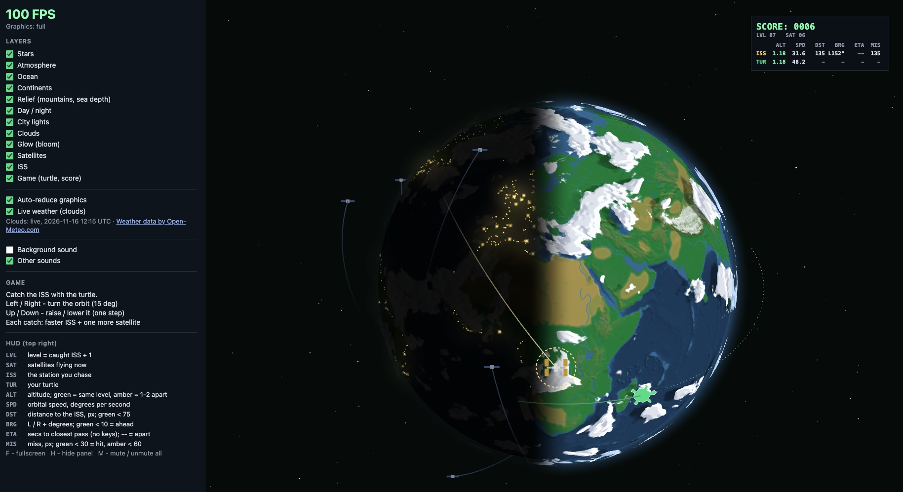

# Deorbit



Fly a turtle on a satellite orbit around a realistic, spinning Earth and catch the ISS. Every catch makes the station burn
up in the atmosphere, raises the level (a faster ISS and one more satellite) and the score. The game has no end: the levels
simply get harder until the ISS reaches 95% of the turtle's speed.

Built with TypeScript, Vite, React Three Fiber (Three.js), zustand and Howler. The ground (continents, lakes, rivers, deserts,
ice) is painted in code at start-up from vector data (Natural Earth), and the city lights are derived from the same data;
the clouds are computed per pixel in a shader and shaped by real weather from Open-Meteo. The only image is a 740 kB relief
map (NOAA ETOPO). There are no audio files: every sound is synthesised.

## Run

```bash
pnpm install
pnpm dev        # http://localhost:5173
pnpm check      # typecheck + lint + tests
pnpm build      # static site in dist/
```

Needs Node 22+ (developed on Node 24) and pnpm. `.npmrc` pins the public npm registry for this folder.

## Controls

| Input | Action |
|---|---|
| `←` `→` | turn the turtle's orbit left / right by 15 degrees |
| `↑` `↓` | raise / lower the orbit by one altitude level (7 levels) |
| `F` / `F11` | fullscreen |
| `H` | hide / show the side panel (layers, FPS) |
| `M` | mute / unmute all sound (the panel has separate switches for the background sound and for the other sounds; remembered) |
| touch | four on-screen buttons, plus panel / sound / fullscreen buttons |

**One press is one step.** Holding a key (or a finger) repeats nothing, so a value never runs away from you. The
instruments in the top-right corner (ALT, SPD, DST, BRG, ETA, MIS) forecast the next 15 seconds, so you can see what a tap
will do before you press it. The side panel lists what every column means.

## How it is organised

```
src/sim/      pure TypeScript game logic - no three.js, no React (a lint rule keeps it that way)
src/render/   React Three Fiber components, shaders, the texture painters; data/ and assets/ are generated (see below)
src/ui/       the HUD, the side panel, touch buttons (plain DOM)
src/audio/    procedural sound synthesis + the Howler wrapper
src/state/    the live simulation and its fixed-step clock, zustand stores (HUD snapshot, settings), auto-quality, the weather loader
tests/        vitest
scripts/      build_terrain.py, build_relief.py (map data generators, see below); gen_golden.py (how the test references were made)
docs/         the screenshot
```

- **The simulation runs at a fixed 40 Hz** (one step = 25 ms) and the render interpolates between
  steps, so the game plays the same on a 60 Hz and a 144 Hz screen. A hidden tab never makes it jump.
- **React never holds game state.** Renderers read the simulation in `useFrame`; the HUD sees a copy refreshed ~15 times a
  second.
- **Units:** the Earth has radius 1. The game was tuned in "design pixels" (a globe radius of 250); those constants are
  converted with `px()` in `sim/config.ts`, and the HUD shows distances in the same pixels.
- **Look:** the renderer runs without colour management, so colours are plain display values and the night shade blends
  those numbers. The Sun never moves: a vertical day/night band, the globe turns beneath it.
- **Clouds** are procedural: a noise (warped, stretched east-west) cut at the local cloud cover, lit from the Sun side, and
  casting shadows on the ground. The cover comes from a coarse weather map (5 degree grid). With **Live weather** on it
  is real cloud cover from [Open-Meteo](https://open-meteo.com) (a 15 degree grid, 288 points, one request); otherwise a
  climate guess (cloudy equator and storm tracks, clear subtropics). The map is fixed to the ground and the clouds drift
  a little faster than the Earth turns. When a new map arrives the clouds **morph** into it over 40 seconds: they grow,
  shrink and dissolve where they are, instead of being redrawn. Clouds are dense, and the city lights under a cloud are
  hidden (found along the line of sight, since the clouds float above the lights).
- **Bloom** is selective: only the fireball, the ring flashes and the city lights are drawn into a small glow target;
  the Earth and the clouds act as black occluders in that pass.
- **Auto quality** watches the median frame time and drops detail one level at a time. Level 1 (reduced): no bloom, no cloud
  shadows or self-shading (a plainer cloud shape), no star twinkle. Level 2 (low): also no satellite trails, atmosphere glow
  or relief shading, only the main light of each city, and one pixel per CSS pixel. Level 3 (minimal): no clouds, city lights
  or stars. It only ever goes down, and starts over when the window is resized or "Auto-reduce graphics" is switched on again.

## Tests

`pnpm test` runs the whole suite (about 100 tests, a few seconds). The simulator is checked against **frozen reference
values** in `tests/golden/golden.json` (forecasts, orbits, speeds, bumps, burns, a catch), computed once by an earlier
prototype implementation of the game. The prototype is not part of this project and nothing needs it: the JSON is
committed, and `scripts/gen_golden.py` only documents how the values were made. If you change the rules on purpose, update
the expected values.

Random choices (the next ISS orbit, the stars) are tested by their properties, and the 10 satellite orbits are fixed data.
The rest of the tests cover the speed system and levels, the HUD numbers, the layout, the day/night curve, the automatic
quality, the synthesised sounds, the map data (seas are water, deserts are deserts, lights follow the coasts and rivers),
the relief map (decoded and checked against the Himalaya and the Mariana Trench), the cloud geometry against the real scene
graph, and the weather schedule with a fake network (a rate limit, being offline, a hidden tab, a reload within the hour).

## Weather

Live weather is the only thing that talks to the network. One request asks Open-Meteo for the cloud cover at a fixed
grid of 288 points of the Earth; **nothing about the player is sent**. The free allowance is 10 000 "calls" a day and
this request costs 288, so it is made **once an hour at most**: the answer is kept in the browser (`localStorage`), a
reload within the hour makes no request, a hidden tab makes none, and a failure (offline, a rate limit) is retried only
after ten minutes, with the climate guess on screen meanwhile. Only one request is ever in flight. The "Live weather"
checkbox in the panel turns it all off (remembered); "Weather data by Open-Meteo.com" (CC BY 4.0) is credited in the panel.
Open-Meteo's free service is for non-commercial use; a commercial deployment needs their paid plan.

While developing: every fresh browser profile makes one request, so a lot of test runs can use up the day's allowance
(the app then just shows the climate guess).

## Terrain data

The land is real: `src/render/data/*.ts` (coast lines, lakes and inland seas, rivers, deserts, glaciers) and
`src/render/assets/relief.png` are **generated** from public-domain sources and committed, so a normal build needs no
network. To rebuild them:

```bash
# Natural Earth 1:50m GeoJSON (land, lakes, rivers_lake_centerlines, glaciated_areas, geography_regions_polys),
# downloaded into an empty folder, then:
python3 -I scripts/build_terrain.py <that folder>

# ETOPO1 at a 0.25 degree grid, from NOAA's ERDDAP server (about 18 MB of CSV):
#   https://coastwatch.pfeg.noaa.gov/erddap/griddap/etopo180.csv?altitude[(-90):15:(90)][(-180):15:(180)]
python3 -I scripts/build_relief.py <that csv>
```

Both scripts use only the Python standard library and read the downloads as plain numbers (nothing in them is executed).
`relief.png` holds the hill shading (R), the height of the land (G) and the depth of the sea (B); the shader browns and
whitens high ground, shades the slopes and lightens the continental shelf.

Credits: weather by [Open-Meteo.com](https://open-meteo.com) (CC BY 4.0); [Natural Earth](https://www.naturalearthdata.com) (public domain); [NOAA ETOPO1](https://www.ncei.noaa.gov/products/etopo-global-relief-model)
(public domain, Amante & Eakins 2009).

## Deploying

`pnpm build` produces a static site in `dist/`. Asset paths are relative, so it works from a domain root, a sub-path or a
plain folder. Any static host will do:

- **GitHub Pages:** the repository ships `.github/workflows/deploy.yml`. Set *Settings > Pages > Build and deployment >
  Source* to **GitHub Actions** once; every push to `main` then checks, builds and publishes the site. Do not commit
  `dist/`: the repository root holds the source `index.html` (it points at `/src/main.tsx` and only works under the dev
  server), and the built one lives in the published artifact.
- **Cloudflare Pages / Netlify / Vercel:** build command `pnpm build`, output directory `dist`.
- **By hand:** copy the contents of `dist/` to any web server.

The download is about 1.2 MB: three.js ~250 kB gzipped, the game and its map data ~140 kB, React ~65 kB and the 740 kB
relief map (a PNG, not compressible further). Everything is cacheable; the first frames appear after ~2 s (the textures are
painted at start-up).

## URL options and developer shortcuts

- `?touch=1` shows the touch buttons on a desktop (works in the built site too).
- Dev server only: `?score=7` starts on level 8 (to look at the satellites without playing).
- Dev server only: `window.__world` is the live simulation and `window.__audio` the sound counters, for the console and
  browser tests.

## Known limits

- Tested in desktop Chrome (about 100 FPS at full quality on one real GPU), on a software renderer and in a phone
  emulation. Not tried on a real phone or in Safari; the sounds are synthesised and have not been tuned by ear.
- The hill shading is lit from the north-west (the cartographic convention), while the day/night light comes from the right.
- The relief map has a 0.25 degree grid (~28 km): fine for a globe, soft if you zoom a long way in. The live weather is a
  15 degree grid (~1 600 km): it decides where the clouds are, and the shader invents the fine structure, so real fronts
  and cyclones are not reproduced.
- The first frames appear after ~2 s: the textures are painted at start-up.

## License

The code is [MIT](LICENSE). The data keeps its own terms: Natural Earth and NOAA ETOPO1 are public domain, the live weather
is Open-Meteo's (CC BY 4.0, free for non-commercial use), see the credits above.
